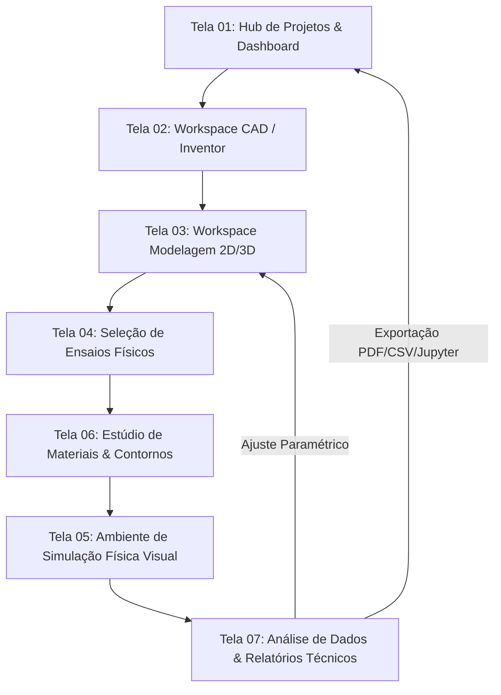

# FisisCAD - Plano Integrado de Arquitetura e Implementação Web

> **Documento Mestre de Planejamento e Especificação Técnica**  
> *Versão:* 2.0 (Expandido com Telas Stitch e Casos de Uso Acadêmico/Engenharia)  
> *Data:* Outubro 2026

---

## 1. Visão Geral e Proposta de Valor

O **FisisCAD** é uma plataforma web unificada de alta performance que integra **Modelagem 3D (CAD)**, **Análise por Elementos Finitos (FEA)**, **Dinâmica dos Fluidos Computacional (CFD)** e **Simulação Física Dinâmica em Tempo Real**.

A plataforma visa conectar a teoria matemática ao protótipo prático, eliminando as barreiras de instalação de softwares CAD/CAE tradicionais pesados. Ela funciona nativamente no navegador através de aceleração gráfica WebGL/WebGPU e compilação de motores físicos em WebAssembly (Wasm).

---

## 2. Personas e Casos de Uso

| Público-Alvo | Necessidades Principais | Casos de Uso no FisisCAD |
| :--- | :--- | :--- |
| **Estudantes de Física Computacional & Engenharia** | Entendimento de fenômenos físicos complexos, validação de exercícios teóricos e listas de cálculo/física. | - Visualização de campos vetoriais de tensão e deformação. - Inspeção nodal e plotagem instantânea de gráficos (ex: $Tensão \times Deformação$). - Exportação de scripts Python/Jupyter para relatórios acadêmicos. |
| **Docentes e Pesquisadores** | Demonstrações interativas em sala de aula, criação de experimentos virtuais reproduzíveis. | - Criação de "Templates de Ensaios" com gabarito físico. - Modo Aula Colaborativa (compartilhamento de sessão via WebRTC/Firebase). - Apresentação visual de modos de vibração e dinâmica de fluidos. |
| **Engenheiros e Projetistas Industriais** | Pré-dimensionamento de componentes mecânicos, verificação rápida de falhas estruturais (Von Mises). | - Modelagem paramétrica 2D/3D rápida. - Atribuição de materiais de engenharia reais e cargas dinâmicas. - Exportação de relatórios técnicos formais em PDF com selo de verificação e arquivos STEP/STL. |

---

## 3. Conexão entre Telas e Fluxo de Navegação (Screen Flow)

O sistema opera com um fluxo contínuo de 6 estágios, permitindo navegar bidirecionalmente sem perder o estado paramétrico da geometria ou dos resultados numéricos.

### Modos de Visualização & Dispositivos
- **Desktop (High-Density UX):** Painéis dockable de 3 colunas, atalhos de teclado produtivos, inspector lateral paramétrico e múltiplos viewports.
- **Mobile / Tablet (Touch-First UX):** Bottom sheets retráteis, controles por gestos (pinch to zoom, 2-finger orbit), botões de ação flutuantes (FABs) e barras de telemetria otimizadas.

---

## 4. Detalhamento Funcional por Tela

### 📄 Tela 01: Hub de Projetos & Dashboard (`01_hub_projetos.html`)
- **Objetivo:** Gestão de projetos cloud/locais e seleção de modelos iniciais.
- **Funcionalidades:**
  - Biblioteca de projetos recentes com cards informativos e miniaturas 3D interativas.
  - Templates Acadêmicos & Industriais: *Viga Bi-Engastada*, *Ensaio de Tração ABNT/ASTM*, *Aerofólio NACA 0012 (CFD)*, *Pêndulo Duplo Não-Linear*.
  - Status do sistema e monitoramento de cota do usuário (Firebase Rules).
  - Importação rápida de arquivos de geometria externa (`.step`, `.stl`, `.iges`, `.obj`).

### 📄 Tela 02: Workspace de Modelagem CAD/Inventor (`02_workspace_cad_inventor.html`)
- **Objetivo:** Modelagem sólida avançada e montagens mecânicas.
- **Funcionalidades:**
  - Árvore Paramétrica de Operações (Feature Tree não destrutiva).
  - Operadores Booleanos sólidos (União, Subtração, Intersecção).
  - Chamfer, Fillet, Shell e padrões de repetição (Linear e Radial Array).
  - Suporte a montagens com restrições de junta mecânica (Revoluta, Prismática, Esférica).

### 📄 Tela 03: Workspace de Modelagem 2D/3D (`03_workspace_modelagem.html`)
- **Objetivo:** Criação de esboços 2D restritos e extrusões rápidas.
- **Funcionalidades:**
  - **Modo Sketch 2D:** Linhas, Círculos, Arcos, Polígonos e Splines Bézier.
  - **Motor de Restrições Geométricas:** Coincidência, Paralelismo, Perpendicularidade, Tangência, Concentricidade e Simetria.
  - Cotas restritivas inteligentes com suporte a fórmulas matemáticas (ex: `L = (R * 2) + 10`).
  - Operadores rápidos de conversão 3D: Extrusão, Revolução (Lathe), Varredura (Sweep) e Loft.

### 📄 Tela 04: Seleção de Ensaios Físicos (`04_selecao_ensaios.html`)
- **Objetivo:** Definição do tipo de estudo físico e solver a ser aplicado.
- **Funcionalidades:**
  - Seleção de categoria: *Estática Estrutural*, *Análise Vibracional/Modal*, *Dinâmica de Fluidos (CFD)*, *Transferência Térmica*, *Colisão & Cinemática Rigida*.
  - Configuração do solver: Tolerância de convergência, número máximo de iterações, passadas de tempo ($\Delta t$).
  - Seleção do motor de computação: Local (WebAssembly no navegador) ou Cloud GPU Cluster.

### 📄 Tela 06: Estúdio de Materiais e Condições de Contorno (`06_estudio_materiais.html`)
- **Objetivo:** Atribuição de propriedades físicas e aplicação de cargas.
- **Funcionalidades:**
  - **Biblioteca de Materiais de Engenharia:** Aço Estrutural ASTM A36, Alumínio 6061-T6, Titânio Ti-6Al-4V, Polímeros (PLA/ABS), Concreto e materiais customizados pelo usuário.
  - **Propriedades Físicas Configuráveis:** Módulo de Elasticidade ($E$), Razão de Poisson ($\nu$), Densidade ($\rho$), Limite de Escoamento ($\sigma_y$), Condutividade Térmica ($k$).
  - **Aplicação de Cargas & Apoios (Boundary Conditions):**
    - Apoios Fixo (Encavado), Articulado (Rolamento), Rótula e Suporte Elástico.
    - Cargas de Força Pontual, Pressão Distribuída, Torque, Carga Térmica e Aceleração Gravitacional.

### 📄 Tela 05: Ambiente de Simulação Física Visual (`05_ambiente_simulacao.html`)
- **Objetivo:** Execução visual da simulação e inspeção dos mapas de calor.
- **Funcionalidades:**
  - Viewport full-bleed com mapas de cor continuos (Rainbow, Viridis, Turbo) para **Tensão de Von Mises**, **Deslocamento** e **Vetor de Velocidade de Fluido**.
  - Barra de controle temporal (Player HUD): Play, Pause, Rewind, Passo a Passo ($\Delta t$) e Scrubbing de linha do tempo.
  - Fator de Escala de Deformação ajustável (ex: $1\times$, $100\times$, $1000\times$) para enfatizar micro-deslocamentos estruturais.
  - Isolar malha de colisão, vetores de força e linhas de corrente (streamlines) de escoamento.

### 📄 Tela 07: Análise de Dados e Relatórios Técnicos (`07_analise_relatorios.html`)
- **Objetivo:** Avaliação quantitativa de resultados e exportação técnica.
- **Funcionalidades:**
  - Gráficos cartesianos interativos: *Tensão vs Deformação*, *Deslocamento vs Tempo*, *Coeficiente de Arrasto ($C_d$) vs Reynolds ($Re$)*.
  - Indicadores KPIs de Engenharia: Fator de Segurança (FoS) Mínimo, Tensão Máxima Global e Nó Crítico.
  - Gerador de Relatório PDF com gráficos, dados do material, parâmetros do ensaio e imagens capturadas do modelo 3D.
  - Exportação de dados numéricos em CSV, JSON e scripts editáveis para Python (Jupyter / Matplotlib).

---

## 5. Funcionalidades Faltantes Identificadas & Melhorias Acadêmico-Profissionais

Para elevar o FisisCAD a uma referência em física computacional e ensino técnico, as seguintes **8 funcionalidades essenciais** foram integradas ao plano:

1. **Editor de Expressões & Parâmetros em LaTeX / Python Syntax:**
   - Permitir definir geometrias e forças usando equações matemáticas explícitas (ex: $F(t) = F_0 e^{-\gamma t} \cos(\omega t)$).
2. **Gerador de Malha Adaptativa (Wasm Mesh Discretizer):**
   - Motor de discretização de superfícies e volumes com refino automático em bordas de alto gradiente de tensão.
3. **Exportador de código para Python / Jupyter Notebook / MATLAB:**
   - Possibilidade de exportar todo o problema configurado em script Python (usando bibliotecas como `SciPy`, `FEniCS` ou `Matplotlib`) para validar em disciplinas de física computacional.
4. **Ferramenta de Seccionamento Dinâmico (Clipping Planes):**
   - Planos de corte $X, Y, Z$ interativos para inspecionar o comportamento de tensões e fluxo no interior dos sólidos.
5. **Modo Sala de Aula Colaborativa (Live Classroom Session):**
   - Transmissão em tempo real do estado da simulação do professor para os alunos usando WebRTC/Firebase.
6. **Comparador A/B de Cenários Estruturais:**
   - Visualização split-screen lado a lado comparando dois materiais ou duas espessuras de peça sob a mesma carga.
7. **Calculadora de Fator de Segurança e Verificação por Normas (ABNT / ASME):**
   - Verificação automática se a peça atende ao critério de escoamento de von Mises ou Tresca com alertas de falha imediata.
8. **Gravador de Animações & Simulação em Vídeo WebM/GIF:**
   - Gravação direta do viewport em animação 60FPS para inclusão em apresentações de trabalhos acadêmicos e TCCs.

---

## 6. Especificações de UX, Navegação 3D e Atalhos

### Navegação Padrão CAD/CAE
- **Orbit (Rotacionar Câmera):** MMB (Botão Central do Mouse) + Arrastar.
- **Pan (Deslocar Câmera):** `Shift` + MMB + Arrastar.
- **Zoom:** Roda do Mouse (Scroll Wheel em relação à posição do cursor).
- **ViewCube:** Cubo 3D interativo no canto superior direito para orientação direta aos planos (*Top, Front, Right, Isometric*).

### Atalhos de Teclado Chave
- `S` - Menu Radial Flutuante (Context HUD).
- `L` - Ferramenta de Linha (Sketch 2D).
- `D` - Cota Restritiva Inteligente (Dimension).
- `E` - Extrusão Sólida 3D.
- `M` - Atribuição de Material / Propriedades Físicas.
- `R` - Executar / Rodar Simulação (Run Simulation).
- `F` / `Espaço` - Centralizar visualização na geometria selecionada (Fit to View).

---

## 7. Arquitetura Técnica e Stack de Tecnologia

- **Front-end UI:** React.js, TailwindCSS (Dark Mode nativo), Lucide/Material Icons.
- **Gerenciamento de Estado Global:** Zustand (armazenamento leve da árvore paramétrica e estado dos ensaios sem re-renders desnecessários).
- **Engine Gráfica 3D & Renderização:** `@react-three/fiber` + `Three.js` + `@react-three/drei` (WebGL/WebGPU).
- **Engine Físico & Solvers:** `Rapier3D` (Rust compilado para WebAssembly para cinemática/rigidbody) + Solvers FEM/CFD em C++/Wasm.
- **Back-end & Persistência (BaaS):** Firebase Auth (OAuth Google), Firestore (armazenamento NoSQL da Feature Tree e parâmetros), Firebase Storage (arquivos CAD/STL/STEP).

---

## 8. Planto de Fases e Tarefas (Task Breakdown)

### Fase 1: Infraestrutura e Rotas da Aplicação
- [ ] Inicialização da estrutura Vite + React + TailwindCSS.
- [ ] Implementação da autenticação Firebase e rotas protegidas.
- [ ] Criação da navegação entre as 7 visões de tela desktop e 4 visões mobile.

### Fase 2: Motor 3D & Navegação CAD
- [ ] Setup do `@react-three/fiber` com suporte a OrbitControls, ViewCube e iluminação industrial.
- [ ] Leitor e renderizador de geometrias `.stl` e `.step` no browser.

### Fase 3: Editor de Esboço 2D e Restrições
- [ ] Canvas 2D interativo com suporte a snapping, linhas, arcos e cotas numéricas.
- [ ] Motor de restrições geométricas e extrusão 3D.

### Fase 4: Estúdio de Materiais & Condições de Contorno
- [ ] Interface de seleção de materiais e criação de propriedades personalizadas.
- [ ] Seletores 3D para aplicação de forças e fixações em superfícies e vértices.

### Fase 5: Integração do Solver Físico (Wasm)
- [ ] Conexão do `Rapier3D` Wasm com o mapa de malha 3D.
- [ ] Loop de simulação com controles de playback (Play/Pause/Scrubbing).

### Fase 6: Pós-Processamento e Relatórios
- [ ] Mapeamento de calor contínuo (Tensões de Von Mises) na malha 3D.
- [ ] Geração de gráficos dinâmicos e exportador de relatórios em PDF e código Python.

---

## 9. Lista de Verificação (Verification Checklist)

- [x] O documento abrange todas as telas desktop (`01` a `07`) e mobile (`01` a `04`) importadas do Stitch?
- [x] Os fluxos de navegação e ligações entre as telas foram mapeados em diagrama legível?
- [x] Os casos de uso para alunos, docentes e engenheiros foram explicitados?
- [x] As funcionalidades faltantes essenciais para física computacional (LaTeX, Python, Wasm Mesh, Clipping Planes, Sala de Aula) foram incluídas?
- [x] O documento mestre `fisiscad-plan.md` foi totalmente atualizado no repositório?
